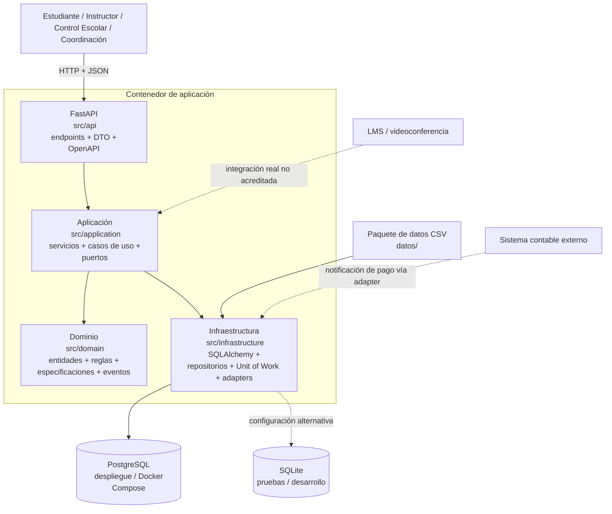
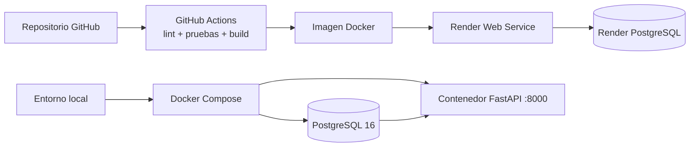

# Diagrama de componentes y despliegue — EduTech Academy

**Vista:** componentes lógicos y despliegue reproducible descrito por los archivos `Dockerfile`, `docker-compose.yml`, `render.yaml` y `src/`. Se muestran PostgreSQL/SQLite como opciones de persistencia configurables.

## Despliegue contemplado

## Responsabilidades y límites

- **API:** traduce solicitudes HTTP a operaciones de aplicación y publica OpenAPI/Swagger.
- **Aplicación:** coordina casos de uso, transacciones y puertos; no concentra las reglas centrales del negocio.
- **Dominio:** contiene entidades, objetos de valor, invariantes, especificaciones y eventos.
- **Infraestructura:** implementa persistencia, carga CSV y adaptadores externos.
- **Persistencia:** PostgreSQL se usa en Docker/Render según configuración; SQLite está contemplado para pruebas y desarrollo.
- **Integraciones externas:** el código incluye un adaptador contable simulado/modelado; no se debe afirmar que existe conexión real con un proveedor contable o LMS.

**Nota:** Render aparece configurado en el repositorio; la existencia de `render.yaml` no demuestra por sí sola que el despliegue esté activo o saludable.
