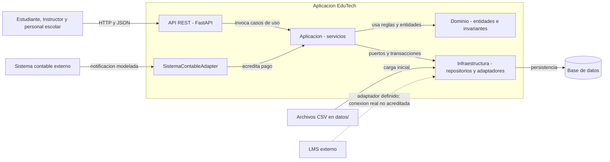
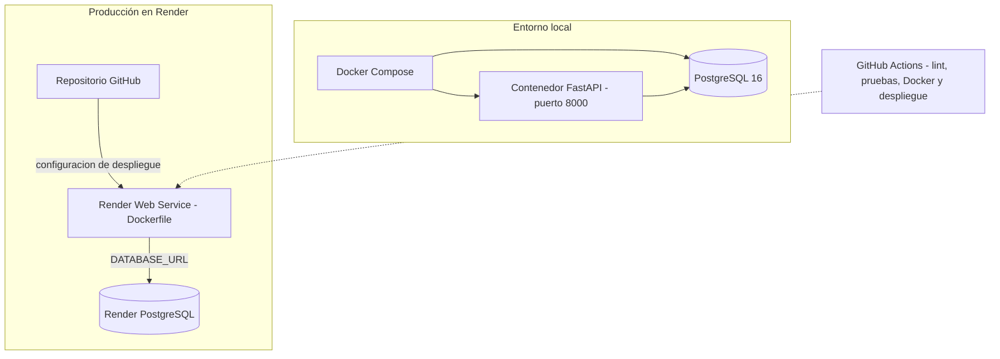

# Diagrama de componentes y despliegue — EduTech Academy

**Vista:** arquitectura lógica y opciones de despliegue descritas por `src/`, `Dockerfile`, `docker-compose.yml` y `render.yaml`. El diagrama separa los componentes de la aplicación de los entornos donde puede ejecutarse.

## Componentes lógicos

## Despliegue local y en producción

## Responsabilidades y límites

- **API (`src/api/`):** expone endpoints HTTP, valida DTO y publica OpenAPI.
- **Aplicación (`src/application/`):** coordina casos de uso, servicios, puertos y transacciones.
- **Dominio (`src/domain/`):** contiene entidades, objetos de valor, reglas, especificaciones y eventos.
- **Infraestructura (`src/infrastructure/`):** implementa persistencia, repositorios, carga CSV y adaptadores.
- **Persistencia:** PostgreSQL está configurado para Docker Compose y Render mediante `DATABASE_URL`. SQLite se utiliza en pruebas y puede configurarse para desarrollo.
- **Sistema contable:** `SistemaContableAdapter` está implementado como adaptador de aplicación; el repositorio no demuestra conexión real con un proveedor externo.
- **LMS:** existe un `LmsAdapter` en el código, pero el repositorio no acredita una conexión real con una plataforma LMS.
- **Render:** `render.yaml` crea el servicio web y la base PostgreSQL. El sistema está desplegado en https://edutech-academy-api.onrender.com (panel en `/panel`, Swagger en `/docs`, salud en `/salud`).
