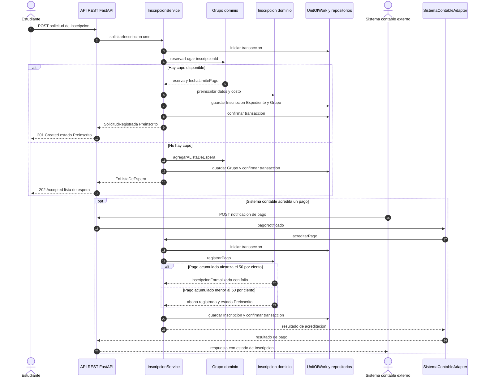

# Diagrama de secuencia — Solicitud de inscripción y pago

**Alcance:** representa el CU-01 implementado en la API: solicitud de inscripción, reserva de lugar o entrada a lista de espera y acreditación de pago. El sistema contable se modela como el origen externo de la notificación de pago; el adaptador incluido en el repositorio delega la operación a `InscripcionService`.

## Correspondencia con el repositorio

- `POST /grupos/{grupoId}/inscripciones`: `src/api/main.py`, operación `inscribir`.
- `InscripcionService.solicitarInscripcion`: `src/application/inscripcion_service.py`; reserva lugar, crea la preinscripción y registra la lista de espera cuando no hay cupo.
- `POST /inscripciones/{inscripcionId}/pagos`: `src/api/main.py`, operación `pagar`.
- `SistemaContableAdapter.pagoNotificado`: `src/infrastructure/adapters.py`; delega en `InscripcionService.acreditarPago`.
- `Inscripcion.registrarPago`: `src/domain/inscripcion.py`; determina si el pago acumulado formaliza la inscripción y genera el folio.

**Límite:** el repositorio contiene un adaptador que modela la notificación del sistema contable, pero no acredita una conexión real con un proveedor contable externo. El diagrama no representa una pasarela bancaria ni una integración real de terceros.
